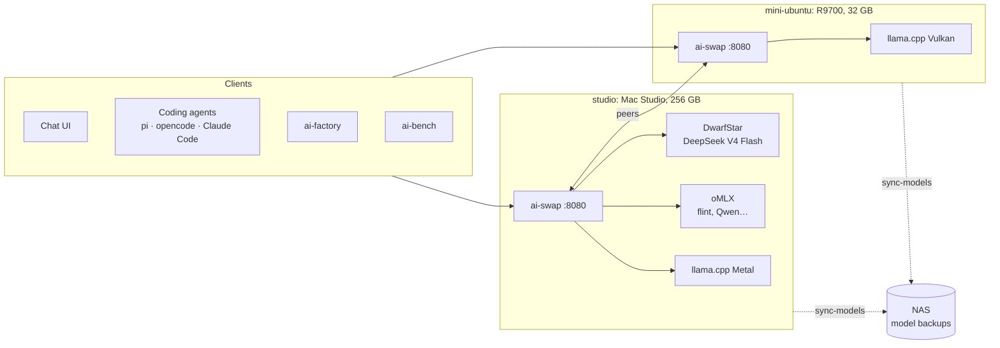
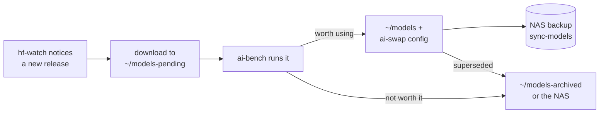

# How the ai-tools suite works

This document explains how the tools fit together. Each tool's own README (or, for the bigger
projects, its README and ARCHITECTURE.md) covers its internals.

## The big picture

Two machines serve models. ai-swap runs on both and joins them into one pool: any client can
ask either machine for any model, and the request ends up on the machine that has it, with the
model loaded on demand. Everything else is a client of that pool.

| Layer | Tools |
|---|---|
| Serving models | ai-swap (one per machine) and the engines it starts |
| Pointing clients at them | ai-swap-clients (both machines), llama-config (Linux box) |
| Using them | coding agents, ai-factory, the chat UI |
| Measuring them | ai-bench |
| Finding and keeping them | hf-watch, sync-models |
| Keeping the checkout in order | suite |

## Machines and network

| | studio | mini-ubuntu | mini-ubuntu2 |
|---|---|---|---|
| Hardware | Mac Studio, M5 Ultra, 256 GB unified memory | Radeon AI PRO R9700 (32 GB VRAM) | Core Ultra 5 125H, 92 GB RAM |
| Network (reserved) | wired (192.168.0.4); Wi-Fi off | Wi-Fi only (192.168.0.3), IPv6 off | wired (192.168.0.7) |
| ai-swap memory budget | 220 GB (~86% of RAM) | 31.8 GB (the card's VRAM) | none: serves no models |
| Engines | DwarfStar, oMLX, llama.cpp b12192 | llama.cpp (Vulkan) | – (runs ai-factory and its Docker sandboxes) |
| Always loaded | flint (36 GB) | qwen3.8-27b (30 GB) | – |

The machines find each other by mDNS name (`studio.local`, `mini-ubuntu.local`) on a TP-Link
router's LAN, with backups on a TrueNAS box (`truenas.local`). Two network details matter:

- mini-ubuntu's Wi-Fi didn't pass IPv6 neighbour discovery from the wired side, and with its
  IPv6 turned off macOS waits 5 s for an IPv6 answer on each lookup of its name. ai-swap dials
  IPv4 first, so it's unaffected; other programs on the Mac that use the name directly pay the
  5 s until a hosts-file entry is added (see TODO.md).
- Traffic to mini-ubuntu crosses Wi-Fi (about 15–35 ms), so the Mac is the better front door for
  latency-sensitive work; requests forwarded through it to mini-ubuntu add about 0.2 s to the
  first token.

## ai-swap: one pool of models

ai-swap is a Go program, one per machine, in front of the inference engines
([its ARCHITECTURE.md](https://github.com/hofftodd/ai-swap/blob/main/ARCHITECTURE.md) has the
internals). Each machine's config lists its own models: engine, model path, memory footprint,
context, aliases. ai-swap starts and stops the engine processes itself, one per model, on ports
it assigns.

**Routing.** A request names a model. If this machine has it, it's served here; otherwise it
goes to the peer that has it. A name that exists on both machines (flint, qwen3.8-27b) means the
local copy; `name@machine` picks a specific one, and `/v1/models` lists the remote copy that way.
Peers poll each other's `/api/node` every 10 s.

**Memory and swapping.** Each model declares `memory_gb`; each machine has a budget. Loading a
model that doesn't fit unloads idle models, least recently used first. A model serving a request
is never unloaded, so the swap waits. Models unload after an idle TTL; *resident* models (flint on
the Mac, qwen3.8-27b on the Linux box) are loaded at startup, exempt from the TTL, and come back by
themselves after something else displaced them.

**Engines.** Each engine has an adapter that knows its flags: `ds4` (DwarfStar, DeepSeek V4
Flash), `omlx` (MLX models, loaded before reporting ready), `llamacpp`, `sushi`, `strata`, and
`generic`. Both OpenAI and Anthropic APIs pass straight through to the engine, so Claude Code
works against local models.

**When a machine is down.** Connections to a peer time out after 3 s; a failed forward marks the
peer offline at once, and requests for its models get `503` with `Retry-After`, naming the
machine, rather than "unknown model". It comes back on the next successful poll.

**Reservations.** A client that needs a machine to itself (an ai-bench run) takes a reservation
(`POST /api/lock`). Until it's released or lapses (default 5 minutes without renewal), only
requests carrying its token are served or may load models there; everyone else gets `503` with
`Retry-After` naming the holder. Idle unloads and resident reloads pause meanwhile, and releasing
brings the residents back.

**llama-swap compatibility.** ai-swap answers llama-swap's `/running`, `/unload` and
`/upstream/<model>/…` for its own models, so tools written for llama-swap keep working. llama-swap
itself is retired (kept in mini-ubuntu's `~/.local/share/retired/llama-swap/`).

**The UI** (`http://<machine>:8080/`) shows every model on every machine, a memory bar per
machine split by model, load/unload/logs, live speeds, reservations, and a chat that labels each
reply with the machine that served it.

## Pointing clients at the pool

Clients talk to one machine's ai-swap and reach every model through it.

- **ai-swap-clients** (both machines) reads `/v1/models` and writes one `ai-swap-<model>` provider
  per model into pi's, oh-my-pi's and opencode's configs, plus a `claude-swap` wrapper for Claude
  Code. It only replaces its own entries. On the Mac it covers every model; on the Linux box it
  runs with `--remote-only`, because llama-config already covers the local ones.
- **llama-config** (Linux box only) scans `~/models` for GGUFs, fits each model's context to the
  R9700's VRAM, writes the ai-swap config (keeping `peers:`), points the clients at the local
  models (`llama-*` providers, `claude-local`), restarts ai-swap, then runs
  `ai-swap-clients --remote-only` for the Mac's models. It also repairs pi's default model if it
  points at a model that no longer exists. It's Linux-only because it relies on a discrete GPU's
  VRAM, llama.cpp alone, systemd and GNU tools; the Mac's config is written by hand.

## ai-factory: agents on the pool

ai-factory ([its ARCHITECTURE.md](https://github.com/hofftodd/ai-factory/blob/main/ARCHITECTURE.md))
runs coding agents in Docker sandboxes: planners agree the documents and the task list, a Tester
writes tests, a Builder writes code, and an orchestrator checks and merges everything. It runs on
one host with its containers (bind-mounted clones and a model gateway require that); a separate
host is preferred, so agents don't compete with models for memory.

ai-factory reaches models through ai-swap. Its *nodes* are ai-swap endpoints, one node per model on the
same URL, so each model has its own capacity and context window. The default bindings come from
ai-bench's results (`ai-factory/specs/000-orchestrator/spike-notes.md`):

| Role | Model | Machine |
|---|---|---|
| Project Planner, Task Planner, Escalation | DeepSeek V4 Flash | studio (DwarfStar) |
| Builder | flint | studio (oMLX) |
| Tester | ThinkingCap-Qwen3.8-27B | mini-ubuntu |

**Avoiding swaps.** An agent step uses its model for minutes, with pauses between requests while
its tools run, but ai-swap only protects a model while a request is in flight. Two steps whose
models don't fit on one machine would swap each other out on almost every turn. So ai-factory reads
ai-swap's status every few seconds (`ai-factory/src/ai_factory/residency.py`) and holds back work whose
model would push out a model another running step is using, works out the victim the way ai-swap
would, starts already-loaded work first, and treats a reserved machine as busy. The project
settings page warns when two agents' models can't share a machine. The bindings above never
conflict: DeepSeek and flint total 211 of the Mac's 220 GB.

## ai-bench: measuring models

ai-bench ([its README](https://github.com/hofftodd/ai-bench)) runs suites against models and writes
results, dashboards and the analyses that chose the models above. Each machine has its own config:

- **`bench.yaml` (mini-ubuntu)** runs llama.cpp models through ai-swap (`type: ai-swap`, which
  uses ai-swap's llama-swap endpoints to unload other models and record each model's settings)
  and starts Strata, Avalon and ROCm builds as its own processes.
- **`bench-mac.yaml` (studio)** starts DwarfStar, oMLX, sushi and llama.cpp itself on fixed ports,
  so measurements don't go through any proxy.

Both configs have `reserve:`, so every run reserves its machine's ai-swap: it unloads ai-swap's
models (freeing the memory on the Mac), sends its token with every request through ai-swap
(including the shell steps that free the GPU, as `$AI_SWAP_LOCK`), renews the reservation, and
releases it at the end, even on errors. Agents and ai-factory see the machine as reserved and wait.
The ai-swap backend also refuses a model this machine doesn't serve, so a result can't be run on
the other machine but labelled with this one's hardware.

## A model's life

- **hf-watch** (a LaunchAgent on the Mac, every 6 hours) searches Hugging Face for named
  models (Inkling Small, Ripple, flint, Qwen4) and for new 7–600B models from US labs, and sends
  one macOS notification per run listing what's new.
- **`~/models-pending/`** holds downloaded models not yet benchmarked; ai-bench's TODO lists them.
- **`~/models/`** holds what ai-swap serves (on the Mac, oMLX models are linked from
  `~/models/omlx/` by model id).
- **`~/models-archived/`** holds models taken out of service. On the Mac the archived files were
  verified against the NAS and can be deleted locally; a README there says how to restore them.
- **sync-models** backs `~/models` up to the NAS: two-way with the Linux box's `models/` share,
  one-way from the Mac to `models-mac/` (it never deletes on the NAS, so archived models stay
  there).

## Where things live

| What | studio | mini-ubuntu |
|---|---|---|
| This suite | `~/dev/ai-tools` | `~/dev/ai-tools` |
| ai-swap config | `~/.config/ai-swap/config.yaml` | `~/.config/ai-swap/config.yaml` |
| ai-swap service | `~/Library/LaunchAgents/com.github.hofftodd.ai-swap.plist`, log `~/Library/Logs/ai-swap.log` | `~/.config/systemd/user/ai-swap.service`, `journalctl --user -u ai-swap` |
| Agent configs | `~/.pi/agent/models.json`, `~/.config/opencode/opencode.json`, `~/.local/bin/claude-swap` | same, plus `~/.omp/agent/models.yml`, `claude-local` |
| Tools on PATH | `~/.local/bin`: ai-swap, ai-swap-clients, sync-models | the same plus llama-config |
| oMLX settings | `~/.omlx/settings.json`, `~/.omlx/model_settings.json` (MTP per model) | — |
| ai-factory | — | `~/.config/ai-factory/` (service and env files, not installed) |
| hf-watch | LaunchAgent `com.thoffman.hf-watch`, state `~/.cache/hf-watch/` | — |

## Ports

| Port | What |
|---|---|
| 8080 | ai-swap (OpenAI, Anthropic, UI) on both machines |
| 9100–9199 | engines started by ai-swap on the Mac |
| 5800–5899 | engines started by ai-swap on the Linux box |
| 8000, 8010, 12345, 5896–5897 | engines started directly by ai-bench on the Mac (DwarfStar, oMLX, sushi, llama.cpp) |
| 8090 | Strata, started by ai-bench on the Linux box |
| 8700, 8701 | ai-factory's dashboard and its model gateway (on its host) |

## Design choices

- **Plain HTTP between everything.** Every interaction is request and response, often streamed:
  chat, agent turns, forwards between machines, status polls, reservations. Each tool keeps its
  own state (ai-swap in memory, ai-factory in SQLite, ai-bench in files). A message broker would add
  a service to run and a single point of failure without solving a problem the tools have; if
  polling ever becomes the bottleneck, an event stream from ai-swap (server-sent events) is the
  next step.
- **No central coordinator.** Every machine runs the same ai-swap and owns its own models; any
  machine is a front door, and losing one loses only its models.
- **ai-factory decides what ai-swap can't see.** ai-swap knows requests; ai-factory knows that an agent
  step spans many of them. Swap avoidance lives in ai-factory, built on ai-swap's status.
- **Reservations instead of conventions.** Benchmarks used to rely on nobody else touching the
  machine; now the machine itself refuses other work while a run holds it.
- **Separate repos, one folder.** ai-swap, ai-factory and ai-bench are standalone projects with
  their own histories and pull requests; `suite` makes the shared layout reproducible on any
  machine.
